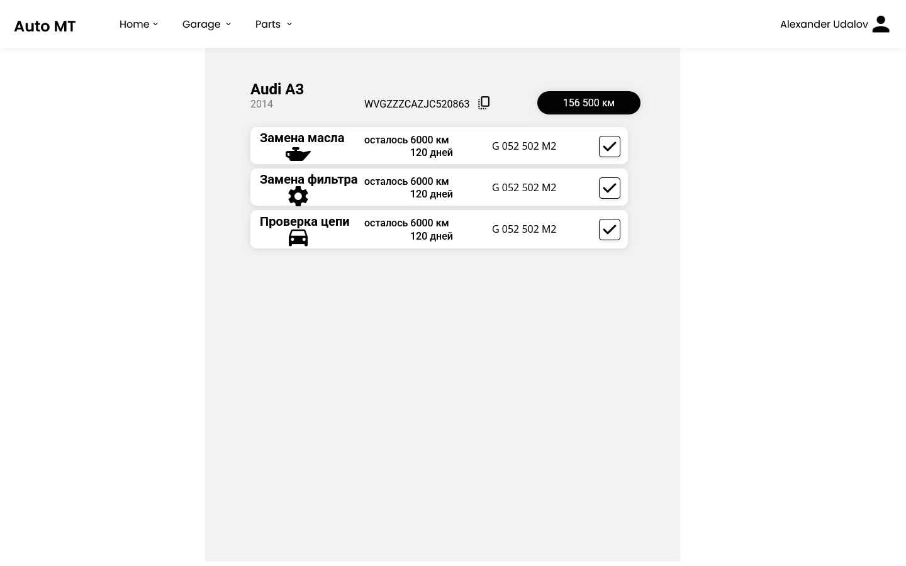
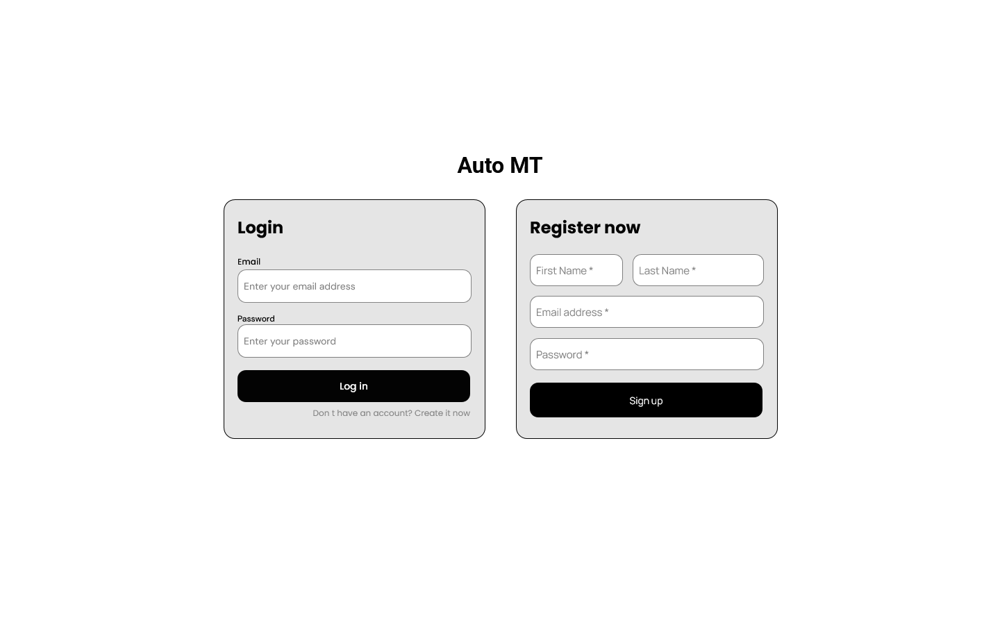
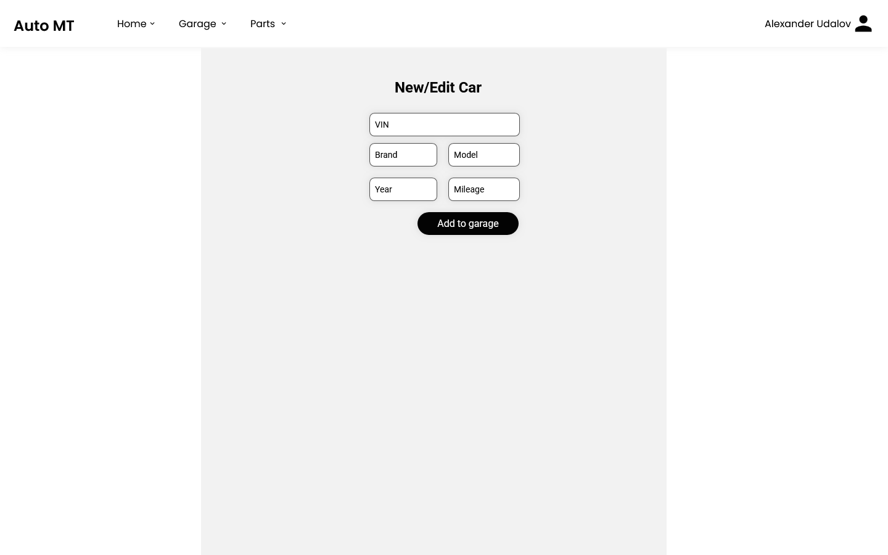
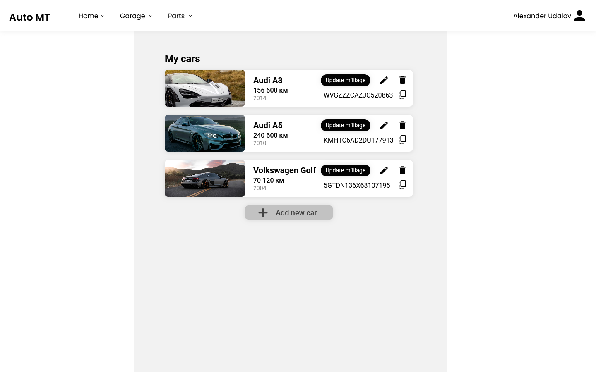

# AutoMT- UI/UX Specefication
- [AutoMT- UI/UX Specefication](#automt--uiux-specefication)
  - [Список страниц](#список-страниц)
    - [Переключение страниц](#переключение-страниц)
    - [Главная страница](#главная-страница)
    - [Страница логина/регистрации](#страница-логинарегистрации)
    - [Страница добавления/редактирования авто](#страница-добавленияредактирования-авто)
    - [Страница управления аккаунтом?](#страница-управления-аккаунтом)
    - [Гараж](#гараж)
## Список страниц
1. Главная страница
2. Страница логина/регистрации
3. Страница добавления/редактирования авто
4. Страница управления аккаунтом?
5. Гараж

### Переключение страниц
Страница гаража и главная страница вынесены в меню хедера. Также в хедере есть икнока аккаунта - через неё открывается страница редактирования аккаунта.
### Главная страница
Список ближайших работ по текущему авто в виде карточек (Например, замена масла - осталось 7 тыс. км (20 дней)).
Если список мотнуть выше - будут завершенные работы. 
Если работа просрочена и не сделана - показывается с значком внимания.
Дополнительно нужно предосмотреть кнопку актуализации пробега
Также есть горизонтальная смена списков - смена машин в гараже

### Страница логина/регистрации

### Страница добавления/редактирования авто
Редактирование также осуществляется через нее, но форма уже заполнена:
Vin
Марка
Модель
Год
Пробег
Движок? Или комплектация? Сразу для подбора количества комплектующих

### Страница управления аккаунтом?
### Гараж
Состоит из карточки с авто ((возможно изоьражение) марка-модель, копируемый vin, пробег, иконка редактирования карточки)
При отсутствии машин показывается надпись типо «еще нет мащин, добавьте новую»
Также в конце списка карточек тоже возможность добавить новое авто. Подумать над сортировкой (по году? По дате добавления?)
Также авто можно сделать «текущим» - он показывается сверху списка и по умолчанию на главной

